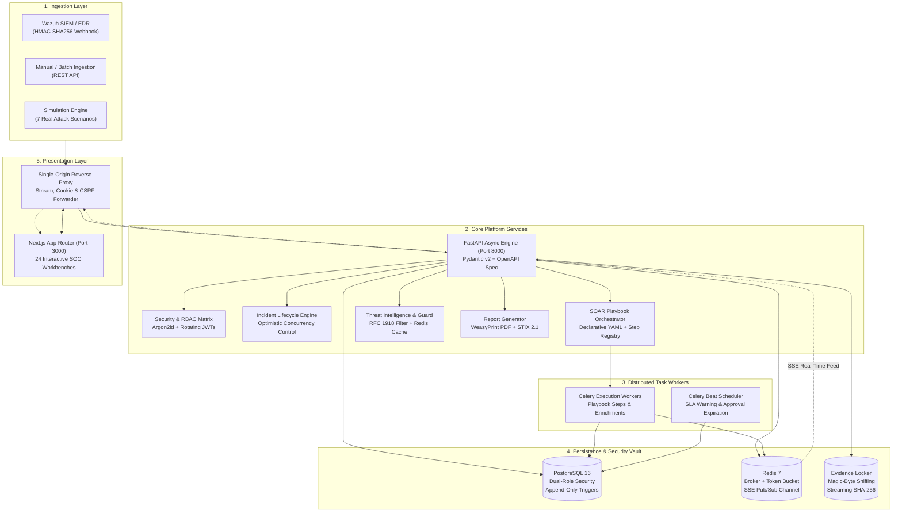

# SENTINEL IR
### Enterprise Security Incident Response, Investigation & SOAR Automation Platform

[](docs/TESTING.md)
[](docs/TESTING.md)
[](docs/SECURITY.md)
[](docs/ARCHITECTURE.md)
[](LICENSE)

**SENTINEL IR** is a serious, production-grade cybersecurity incident response platform designed to reflect modern Security Operations Center (SOC) engineering realities. It unifies high-throughput SIEM/EDR alert ingestion, real-time triage, forensic evidence preservation, threat intelligence enrichment, offline MITRE ATT&CK matrix alignment, declarative SOAR playbook automation, strict four-eyes response governance, multi-format executive reporting, and live database-reconciled SOC analytics.

---

## 1. High-Level System Architecture



---

## 2. Key Enterprise Capabilities

### 🛡️ Secure Ingestion & Deduplication
- **HMAC-SHA256 Wazuh Integration:** Authenticated webhook ingestion with timestamp drift protection (<= 300s) and Redis replay nonce caching.
- **Deterministic Deduplication:** Generates SHA-256 event fingerprints; increments occurrences and links raw payloads without creating redundant alert noise.

### 🔍 Forensic Investigation & Evidence Locker
- **Strict State Machine:** Explicit transitions (`NEW` → `TRIAGED` → `INVESTIGATING` → `CONTAINMENT` → `ERADICATION` → `RECOVERY` → `RESOLVED` → `CLOSED`) with mandatory closure justifications.
- **Optimistic Concurrency Control:** Integer `version` column prevents lost updates across simultaneous analyst actions (`409 OPTIMISTIC_LOCK_CONFLICT`).
- **Forensic Evidence Vault:** Streaming SHA-256 hashing during upload, magic-byte inspection (blocking disguised PE/ELF/Mach-O binaries), path traversal defense, and immutable chain-of-custody tracking.

### 🌐 Threat Intelligence & MITRE ATT&CK
- **Zero-Trust Egress Guard:** Indicator enrichment strictly checks `is_internal_ip()` against RFC 1918, RFC 5737 (`198.51.100.0/24`), RFC 3849, and private domain names to eliminate SSRF and operational data leakage.
- **Token-Bucket Rate Limiter:** Enforces API rate limits in Redis across threat intelligence providers.
- **Offline MITRE STIX Loader:** Parses offline enterprise STIX 2.1 matrix (637+ techniques across 14 tactics) with full-text search and confidence-weighted incident technique mapping.

### ⚡ SOAR Playbook Automation & Four-Eyes Governance
- **Declarative YAML Definitions:** Five built-in incident response playbooks with retry mechanics, step branching, and zero-code YAML extensibility.
- **Four-Eyes Approval Rule:** Disruptive containment actions (firewall block, account suspension, host isolation) pause in persistent `WAITING_APPROVAL`. The backend rejects self-approval attempts (`approver_id == requester_id`) with HTTP `403 FOUR_EYES_VIOLATION`.
- **Safe Simulated Adapter:** Responses execute safely via `SimulatedResponseAdapter`, recording complete audit telemetry without modifying external infrastructure.

### 📊 Attack Simulations, Reports & SOC Analytics
- **7 Realistic Attack Scenarios:** Ingests realistic telemetry for Brute Force, Malware, Phishing, Unauthorized Access, Ransomware, Data Exfiltration, and Insider Threat.
- **Cryptographic Reports:** Generates print-ready executive PDFs via WeasyPrint, versioned JSON, and OASIS STIX 2.1 bundles with SHA-256 chain-of-custody signing.
- **Live SOC Analytics:** Calculates MTTA, MTTR, SLA compliance, and playbook success metrics directly via PostgreSQL aggregations with optional simulation data toggle.

---

## 3. Quickstart Guide

### Prerequisites
- Docker Engine 24+ & Docker Compose v2
- Python 3.12+ (for local test development)
- Node.js 20+ (for local UI development)

### Step 1: Clone and Initialize Secrets
```bash
git clone <repository_url>
cd "SOC INCIDENT AND RESPONSE"

# Generate cryptographically secure .env file
python3 scripts/init_dev_env.py
```

### Step 2: Build & Start All Services
```bash
docker compose up -d --build --wait
```
This starts all six containers (`postgres`, `redis`, `api`, `worker`, `beat`, `web`) and awaits healthy status.

### Step 3: Access the Platform
- **SOC Web Console:** [http://127.0.0.1:3001](http://127.0.0.1:3001) or [http://localhost:3000](http://localhost:3000)
- **FastAPI Documentation:** [http://127.0.0.1:8000/docs](http://127.0.0.1:8000/docs)
- **Readiness Probe:** [http://127.0.0.1:8000/health/ready](http://127.0.0.1:8000/health/ready)

---

## 4. Demo Personas & Credentials

| Persona | Username | Role | Purpose / Scope |
|---|---|---|---|
| **Alex Rivera** | `alex.rivera` | `soc_l1` | Alert triage, note addition, indicator lookup, running simulations |
| **Sam Taylor** | `sam.taylor` | `soc_l2` | Incident investigation, playbook dry-run/run, Tier 1 approvals, closing incidents |
| **Morgan Chen** | `morgan.chen` | `soc_manager` | Tier 2 approvals, reopening incidents, audit log review, simulation reset |
| **Jordan Vance** | `jordan.vance` | `admin` | User administration, security controls, system configuration |

> **Default Password:** `SentinelSecure2026!` (configured via `.env`)

---

## 5. Verification & Testing

SENTINEL IR maintains a 100% passing test gate across all layers:

```bash
# 1. Run Complete Backend Test Suite (41 tests across M0-M6)
DYLD_FALLBACK_LIBRARY_PATH=/opt/homebrew/lib .venv/bin/pytest backend/tests -v

# 2. Run Playwright End-to-End Suite (8 browser workflows)
npm --prefix frontend run test:e2e

# 3. Run Static Security & Code Quality Scans
.venv/bin/ruff check backend scripts
.venv/bin/bandit -r backend/app -ll -q
.venv/bin/mypy --config-file backend/pyproject.toml backend/app backend/tests
.venv/bin/python scripts/generate_openapi_client.py --check

# 4. Run Frontend Checks & Production Build
npm --prefix frontend run typecheck
npm --prefix frontend test -- --run
npm --prefix frontend run build
```

---

## 6. Complete Documentation Index

- **[System Architecture (docs/ARCHITECTURE.md)](docs/ARCHITECTURE.md):** In-depth component diagrams, data flows, Celery workers, Redis pub/sub SSE architecture, and threat modeling.
- **[Security Architecture (docs/SECURITY.md)](docs/SECURITY.md):** OWASP ASVS 4.0 Level 2 compliance matrix, Argon2id parameters, rotating refresh tokens, four-eyes governance, and evidence security.
- **[Demonstration Runbook (docs/DEMO_GUIDE.md)](docs/DEMO_GUIDE.md):** 14-step interview runbook walking through the complete incident response lifecycle.
- **[Verification & Testing (docs/TESTING.md)](docs/TESTING.md):** Pytest suite breakdown, Playwright E2E matrix, and static security scanning guide.
- **[Production Deployment (docs/DEPLOYMENT.md)](docs/DEPLOYMENT.md):** Docker Compose production hardening, environment variables, PostgreSQL dual-role ACLs, and disaster recovery.
- **[Architecture Decision Records (docs/DECISIONS.md)](docs/DECISIONS.md):** 14 ADRs documenting key engineering decisions and trade-offs.

