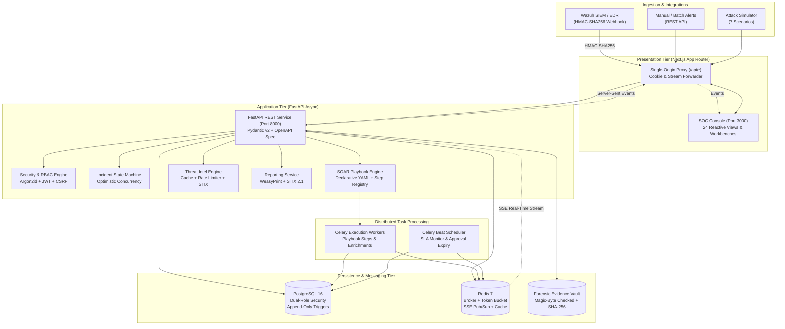

# SENTINEL IR — System Architecture Specification

## 1. Executive Architecture Overview

**SENTINEL IR** is an enterprise-grade Security Operations Center (SOC) Incident Response, Investigation, and SOAR (Security Orchestration, Automation, and Response) platform. Architected for high-concurrency SOC environments, it integrates alert ingestion, automated triage, forensic investigation, threat intelligence enrichment, MITRE ATT&CK alignment, declarative playbook orchestration, four-eyes response governance, multi-format reporting, and real-time operational analytics.

---

## 2. Core Architectural Principles

1. **Defense-in-Depth & Least Privilege:**
   - Database operations run under `sentinel_app`, restricted from altering schema or mutating audit/approval records.
   - All REST endpoints declare strict server-side RBAC dependencies (`require_permission`).
   - Browser client runs entirely through a single-origin Next.js reverse-proxy to eliminate CORS risks and protect `httpOnly` authentication cookies.

2. **Tamper-Evident & Immutable Records:**
   - Audit logs (`audit_logs`) and human approvals (`response_approvals`) are guarded by database-level triggers (`prevent_append_only_mutation()`) that raise PostgreSQL exceptions on any `UPDATE`, `DELETE`, or `TRUNCATE`.
   - Each audit log entry is linked to its predecessor via an advisory-locked cryptographic SHA-256 hash chain (`sha256(prev_hash + sequence_id + payload)`).

3. **Deterministic Human Governance (Four-Eyes Principle):**
   - Critical response actions (account containment, firewall blocks, endpoint isolations) pause execution in a persistent `WAITING_APPROVAL` state.
   - The original requesting analyst or automation runner cannot self-approve.
   - Approval requires a separate authorized user with designated response approval permissions (`RESPONSE_APPROVE_TIER1` or `RESPONSE_APPROVE_TIER2`).

4. **Zero-Trust Egress Isolation:**
   - Threat intelligence lookups strictly filter RFC 1918 private IP ranges, RFC 5737 test ranges (`198.51.100.0/24`, `203.0.113.0/24`), RFC 3849 IPv6 ranges, and internal domain names to prevent SSRF and operational data leakage.
   - Automated response actions utilize a safe `SimulatedResponseAdapter`, recording full audit telemetry without modifying live infrastructure.

---

## 3. Component Breakdown

### 3.1 Presentation Tier (Next.js 14.2 App Router)
- **Directory Structure:** `frontend/src/app`
- **Routing:** 24 dedicated routes covering alerts, triage, incidents, forensic workbench, evidence locker, playbooks, approval queues, simulations, reports, and analytics.
- **Single-Origin Proxy:** Located at `frontend/src/app/api/[...path]/route.ts`. Forwards incoming requests to `http://api:8000/api/v1/*` while preserving multi-cookie `Set-Cookie` headers, CSRF headers, binary file streams (WeasyPrint PDF, STIX 2.1 bundles, evidence files), and real-time Server-Sent Events (SSE).
- **Design System:** Tailwind CSS with a dark SOC high-contrast color palette, Lucide icons, accessible badges, and responsive tables.

### 3.2 Application Service Tier (FastAPI Async)
- **Directory Structure:** `backend/app/`
- **ASGI Server:** Uvicorn running FastAPI with native async I/O.
- **Data Validation:** Strict Pydantic v2 schemas for all requests, responses, and events.
- **Authentication & Security:**
  - Password hashing: Argon2id (`argon2_cffi`) with timing mitigation for nonexistent usernames.
  - Access Tokens: Short-lived HMAC-SHA256 JWTs with explicit claims (`sub`, `username`, `role`, `jti`, `exp`, `iat`, `iss`, `aud`).
  - Refresh Tokens: Stored in PostgreSQL with automatic rotation and cryptographic family reuse detection.
  - CSRF: Double-submit cookie with cryptographic verification on state-changing requests.

### 3.3 Asynchronous Workers & Scheduling (Celery & Redis)
- **Broker & Backend:** Redis 7 (`redis://redis:6379/0`).
- **Worker (`sentinel_worker`):** Executes asynchronous playbook steps, dry-runs, external webhook notifications, and threat intelligence enrichments.
- **Beat Scheduler (`sentinel_beat`):** Schedules recurring tasks:
  - Incident SLA tracking & escalation warnings (every 60s).
  - Response approval expiration checks (every 30s).
  - Expired session cleanup (every 10m).

### 3.4 Data Persistence & Vault Storage
- **PostgreSQL 16:**
  - `sentinel_owner`: Owns tables, runs Alembic migrations, defines security triggers.
  - `sentinel_app`: Runtime user granted standard `DML` (`SELECT`, `INSERT`, `UPDATE`, `DELETE`) on operational tables, explicitly denied `UPDATE/DELETE/TRUNCATE` on `audit_logs` and `response_approvals`.
- **Redis 7:**
  - Database `0`: Celery task broker and results.
  - Database `1`: Token-bucket rate limiting and threat intel caching.
  - Database `2`: Real-time SSE Pub/Sub channel (`sentinel:sse:broadcast`).
- **Forensic Storage Vault:** Dedicated host-mounted volume with strict path containment, streaming SHA-256 hashing, and magic-byte signature validation (rejecting disguised PE/ELF/Mach-O binaries).

---

## 4. Data Flow Architectures

### 4.1 Ingestion to Incident Flow
1. **Webhook Reception:** Wazuh or external agent posts to `/api/v1/ingest/wazuh`.
2. **Signature & Replay Verification:**
   - Computes `HMAC-SHA256(payload, secret)`.
   - Checks timestamp drift (<= 300s).
   - Verifies nonce against Redis replay cache (TTL 300s).
3. **Normalization & Deduplication:**
   - Computes `fingerprint = sha256(rule_id + agent_id + source_ip + target_user)`.
   - Checks for existing active alert within deduplication window (3600s).
   - If matched, increments `occurrence_count` and records `AlertOccurrence`. Otherwise inserts new `Alert`.
4. **Triage & Escalation:**
   - Analyst inspects alert in Triage Workbench (`/alerts/[id]/triage`).
   - Promotes alert to Incident (`POST /api/v1/incidents`).
   - Generates sequential incident identifier `INC-YYYY-NNNN` under PostgreSQL sequence.

### 4.2 Playbook Execution & Four-Eyes Governance Flow
1. **Trigger:** Manual trigger by analyst or automated policy rule.
2. **Execution Initialization:**
   - Validates playbook definition YAML against step registry.
   - Persists `PlaybookExecution` in `RUNNING` state.
3. **Automated Step Processing:**
   - Celery worker executes non-destructive steps (indicator extraction, threat lookup, timeline annotation).
4. **Human Approval Gate:**
   - Playbook encounters human-approved action (e.g. `block_perimeter_ip`).
   - Execution status shifts to `WAITING_APPROVAL`.
   - System records `ResponseAction` and dispatches notification (In-app + Slack/Teams).
5. **Approval Decision:**
   - Authorized responder (`soc_l2`, `soc_manager`, or `admin`) reviews request.
   - Backend enforces Four-Eyes rule: `approver_id != requester_id`.
   - On approval: Action executes via `SimulatedResponseAdapter`, execution transitions to `COMPLETED`.
   - On rejection: Execution terminates with `REJECTED`, logging mandatory justification.

---

## 5. Threat Modeling & STRIDE Matrix

| Threat Category | Potential Threat | SENTINEL IR Architectural Countermeasure |
|---|---|---|
| **Spoofing** | Forged webhook alerts or impersonated analysts | HMAC-SHA256 webhook signatures with nonce checks; Argon2id password hashing; short-lived JWTs. |
| **Tampering** | Malicious deletion of audit logs or approval overrides | PostgreSQL triggers preventing `UPDATE/DELETE/TRUNCATE`; SHA-256 advisory-locked hash chain. |
| **Repudiation** | Analyst denies initiating disruptive response action | Immutable `AuditLog` and `ResponseApproval` recording requester ID, approver ID, timestamp, and IP. |
| **Information Disclosure** | Data leakage to external threat intel APIs | Strict RFC 1918 / RFC 5737 internal IP and private domain filtering before any external lookup. |
| **Denial of Service** | Webhook flooding or API abuse | Redis token-bucket rate limiter; Celery concurrency limits; query pagination caps. |
| **Elevation of Privilege** | L1 analyst executing manager-level response actions | Server-side RBAC dependency injection checking specific permissions on every endpoint. |

---

## 6. Traffic Classification & TLP Handling

All incident records, evidence, and exported artifacts enforce US-CERT Traffic Light Protocol (TLP) standards:
- **TLP:CLEAR:** Publicly disclosable information (e.g. general security advisories).
- **TLP:GREEN:** Information shareable within the organization and partner communities.
- **TLP:AMBER:** Restricted to members of the organization who have a need-to-know.
- **TLP:AMBER+STRICT:** Strictly restricted to the direct incident response team.
- **TLP:RED:** Highly confidential; non-disclosable outside designated participants.

