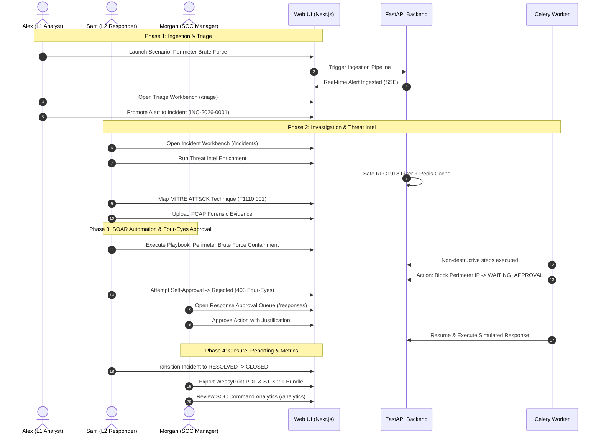

# SENTINEL IR — Demonstration Runbook & Interview Guide

This guide provides an end-to-end, 14-step operational walkthrough of **SENTINEL IR** designed for technical hiring managers, SOC directors, and security engineering interviewers. It showcases the complete incident lifecycle across four authenticated SOC personas.

---

## 1. Demo Credentials & Personas

| Persona | Username | Role / Tier | Key Permissions |
|---|---|---|---|
| **Alex Rivera** | `alex.rivera` | `soc_l1` (Tier 1 Analyst) | Alert triage, incident enrichment, note entry, simulations. |
| **Sam Taylor** | `sam.taylor` | `soc_l2` (Incident Responder) | Incident escalation, playbook execution, Tier 1 approvals, incident closure. |
| **Morgan Chen** | `morgan.chen` | `soc_manager` (SOC Manager) | Tier 2 approvals, incident reopening, audit inspection, simulation reset. |
| **Jordan Vance** | `jordan.vance` | `admin` (Platform Admin) | User management, security configuration, system unlock. |

> **Default Password:** `SentinelSecure2026!` (configured via `.env`)

---

## 2. The 14-Step Incident Response Lifecycle Walkthrough

---

### Step 1: Authentication & Access Control
1. Navigate to `http://127.0.0.1:3001/login` (or `http://localhost:3000/login`).
2. Attempt login with invalid credentials (`alex.rivera` / `WrongPassword!`).
   - *Result:* Rejection with clear, rate-limited error banner.
3. Login as **Alex Rivera** (`alex.rivera` / `SentinelSecure2026!`).
   - *Result:* Redirected to the Command Center dashboard with active session cookies (`sentinel_access` and `sentinel_refresh`) set as `httpOnly` and `SameSite=Strict`.

---

### Step 2: Triggering an Incident Simulation
1. Navigate to **Simulations** (`/simulations`).
2. Select **Perimeter Brute-Force & Credential Spraying** (`SIM-SCN-001`).
3. Click **Launch Scenario** with mode set to `FULL_PIPELINE`.
4. *Talking Point:* Notice that the simulation does not insert fake rows into a table. It dispatches realistic security telemetry through the authentic `/api/v1/ingest/wazuh` endpoint with HMAC-SHA256 signatures, exercising real deduplication and event pipelines.

---

### Step 3: SOC Alert Ingestion & Triage Workbench
1. Navigate to **Alerts** (`/alerts`).
2. Observe the incoming brute force alert with high severity and indicator badges.
3. Click **Triage Alert** to enter the dedicated Triage Workbench (`/alerts/[id]/triage`).
4. Review the correlation metadata, source IP (`198.51.100.42`), and targeted account (`jdoe@company.internal`).
5. Select triage status **Escalate to Incident** and click **Promote to Incident**.
   - *Result:* Sequential incident `INC-2026-NNNN` is minted under database sequence locking.

---

### Step 4: Incident Investigation & Concurrency Controls
1. Navigate to **Incidents** (`/incidents`) and click on the newly created incident.
2. Advance the incident state from `NEW` → `TRIAGED` → `INVESTIGATING`.
3. *Talking Point:* Explain the Optimistic Concurrency Control (`version` column). If two analysts submit state changes concurrently, the second receives an HTTP `409 OPTIMISTIC_LOCK_CONFLICT` rather than silently overwriting data.

---

### Step 5: Threat Intelligence Enrichment & RFC 1918 Guard
1. In the Incident view, switch to the **Indicators** tab.
2. Click **Enrich Indicators**.
3. *Talking Point:* Explain that external malicious indicators (e.g. Tor exit nodes) query external sources and cache results in Redis with a token-bucket rate limiter. However, internal indicators (RFC 1918 private subnets and RFC 5737 synthetic IPs) are flagged by `is_internal_indicator()` and prevented from leaking to public APIs.

---

### Step 6: MITRE ATT&CK Matrix Alignment
1. Navigate to the **MITRE ATT&CK** tab of the incident.
2. Search for `Brute Force` or technique `T1110.001` (Password Guessing).
3. Click **Confirm Technique Mapping**.
4. Navigate to the global **MITRE Explorer** (`/mitre`) to see the enterprise heat map highlight coverage across the 14 ATT&CK tactics based on active incidents.

---

### Step 7: Forensic Evidence Vault & Magic Byte Sniffing
1. Navigate to the **Evidence** tab of the incident.
2. Click **Upload Evidence Artifact**.
3. Upload a sample `.pcap` or `.log` file with custody notes: *"Network capture of perimeter bastion host."*
4. *Talking Point:* Highlight the security controls:
   - Real-time streaming SHA-256 calculation.
   - Magic-byte verification (rejects disguised executable binaries).
   - Strict path traversal neutralization.
   - Immutability with soft withdrawal and audit trail.

---

### Step 8: SOAR Playbook Execution
1. Navigate to **Playbooks** (`/playbooks`).
2. Select **Perimeter Brute Force Containment & Threat Isolation** (`perimeter-brute-force-containment`).
3. Inspect the declarative YAML definition showing automated enrichment steps followed by a gated response action (`block_perimeter_ip`).
4. Click **Execute Playbook** against the active incident.
5. The execution begins immediately via Celery workers, completing automated steps before transitioning to `WAITING_APPROVAL`.

---

### Step 9: Four-Eyes Governance & Rejection of Self-Approval
1. While still logged in as Alex Rivera, navigate to **Response Approvals** (`/responses`).
2. Locate the pending `block_perimeter_ip` action.
3. Click **Approve**.
   - *Result:* An error modal appears: **403 FOUR_EYES_VIOLATION: Requester cannot approve their own action.**
4. *Talking Point:* This proves real enterprise governance. Automated response actions cannot be authorized by the requester or executing service account.

---

### Step 10: Multi-Persona Four-Eyes Authorization
1. Click the user menu in the top right and select **Logout**.
2. Login as **Morgan Chen** (`morgan.chen` / `SentinelSecure2026!`), the SOC Manager.
3. Navigate to **Response Approvals** (`/responses`).
4. Click **Review Action** on the pending request.
5. Enter the justification: *"Verified malicious IP 198.51.100.42 exhibiting persistent credential spraying. Approved for automated perimeter firewall block."*
6. Click **Approve Action**.
   - *Result:* Action status changes to `APPROVED`. Celery worker resumes the playbook, executes the `SimulatedResponseAdapter`, and marks the playbook `COMPLETED`.

---

### Step 11: Real-Time Server-Sent Events (SSE) Demonstration
1. Open two browser windows side-by-side.
2. In Window 1, update an incident note or change severity.
3. In Window 2, observe the real-time update appear dynamically without a manual page refresh.
4. *Talking Point:* Architecture uses Redis Pub/Sub (`sentinel:sse:broadcast`) with automatic 15-second heartbeats and `Last-Event-ID` message replay buffer.

---

### Step 12: Incident Resolution & Closure Governance
1. Log in as Incident Responder **Sam Taylor** (`sam.taylor`).
2. Open the incident and advance status from `INVESTIGATING` → `CONTAINMENT` → `ERADICATION` → `RECOVERY` → `RESOLVED` → `CLOSED`.
3. Attempt to close without a category and 10+ character justification.
   - *Result:* Validation error preventing premature or unclassified closure.
4. Provide category `TRUE_POSITIVE_BENIGN` and a thorough justification to successfully close the incident.

---

### Step 13: Executive PDF, JSON & STIX 2.1 Report Generation
1. Navigate to **Reports** (`/reports`).
2. Select the incident and click **Generate Report**.
3. Click **Download Executive PDF**.
   - *Result:* Opens a print-ready PDF rendered via WeasyPrint featuring high-resolution typography, TLP badges, full investigation timeline, evidence hashes, and a distinct diagonal "SIMULATED INCIDENT" watermark.
4. Click **Download STIX 2.1 Bundle**.
   - *Result:* Downloads a valid OASIS STIX 2.1 JSON bundle containing linked `incident`, `indicator`, `attack-pattern`, and `observed-data` SDOs ready for threat sharing (TAXII).

---

### Step 14: SOC Analytics & KPI Dashboard
1. Navigate to **SOC Analytics** (`/analytics`).
2. Review the live KPIs calculated directly via PostgreSQL aggregations:
   - **MTTA** (Mean Time to Acknowledge).
   - **MTTR** (Mean Time to Resolve).
   - **SLA Breach Ratio** and active alerts count.
   - Playbook execution success rates and average approval turnaround times.
3. Toggle the **Include Simulated Data** filter to observe live reconciliation between production baseline and training simulations.

