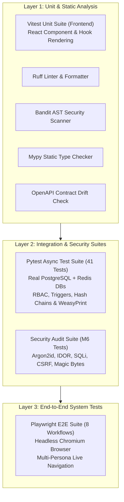

# SENTINEL IR — Verification & Testing Guide

## 1. Testing Strategy Overview

**SENTINEL IR** employs a multi-layered verification strategy that tests real interconnected services rather than isolated mocks. All database and caching tests run against actual **PostgreSQL 16** and **Redis 7** instances, verifying real transaction isolation, SQL triggers, advisory locks, and Pub/Sub mechanics.



---

## 2. Test Suites Breakdown

### 2.1 Backend Pytest Suite (41 Tests across M0–M6)
The backend test suite is executed using `pytest` with `pytest-asyncio`. It provisions an isolated `sentinel_ir_test` database, verifies clean Alembic migration cycles (`upgrade -> downgrade -> upgrade`), and exercises all platform subsystems.

| Test File | Focus Area | Test Count | Key Invariants Verified |
|---|---|:---:|---|
| `test_m0_foundations.py` | Infrastructure Foundations | 3 | Default secret refusal in production, structured JSON log masking, health probes. |
| `test_m1_vertical_slice.py` | Auth, RBAC & Ingestion | 5 | Cookie auth, CSRF, refresh reuse revocation, full RBAC matrix, audit log immutability, HMAC-SHA256 Wazuh webhook with deduplication. |
| `test_m2_investigation.py` | Lifecycle & Evidence | 5 | State machine transitions, optimistic concurrency lock (`409`), evidence magic-byte sniffing, SSE streaming with `Last-Event-ID` replay, notification lifecycle. |
| `test_m3_enrichment_mitre.py` | Threat Intel & MITRE | 5 | RFC 1918 private IP guard, Redis cache, token bucket rate limiter, offline STIX matrix search, incident technique mapping. |
| `test_m4_playbooks_approvals.py` | SOAR & Governance | 7 | YAML playbook parsing, dry-run execution, persistent `WAITING_APPROVAL`, rejection halts, approval expiry, simulated response telemetry, 6th zero-code playbook extensibility. |
| `test_m5_simulation_reporting_analytics.py` | Simulations & Reports | 8 | 7 scenario definitions, full ingestion execution, data reset safety, WeasyPrint PDF binary generation, OASIS STIX 2.1 export, live SQL analytics reconciliation, webhook formatters. |
| `test_m6_security_audit.py` | ASVS L2 Security Audit | 8 | Argon2id strength, JWT expiration rejection, double-submit CSRF, server-side RBAC enforcement, IDOR & SQL injection defense, append-only trigger immutability, four-eyes violation `403`, file magic-byte enforcement. |

### 2.2 Frontend Vitest Suite
Tests React client hooks and UI utility components in JSDOM:
- Location: `frontend/src/__tests__/`
- Runs: `npm --prefix frontend test -- --run`

### 2.3 Playwright End-to-End Suite (8 Core Workflows)
Tests complete browser interactions against the running Docker stack at `http://127.0.0.1:3000`:
- Location: `frontend/e2e/workflows.spec.ts`
- Workflows Tested:
  1. **Authentication:** Valid login, invalid credentials error, account lockout UI, protected route redirects.
  2. **Alert Triage:** Inbox filters, alert triage workbench navigation, promotion to incident.
  3. **Incident Investigation:** Timeline, note addition, indicator lookup, evidence locker.
  4. **Playbooks:** Library catalog, YAML workflow inspection, execution launch.
  5. **Four-Eyes Approvals:** Pending approval queue inspection, justification entry.
  6. **Attack Simulations:** 7-scenario catalog, parameter inputs, execution monitor.
  7. **Reports:** Incident report generation modal, PDF & STIX 2.1 download triggers.
  8. **SOC Analytics:** Live KPI scorecards, MTTA/MTTR charts, simulation data toggles.

---

## 3. Running Test Commands

### 3.1 Backend Test Execution
```bash
# Run the complete backend test suite against local PostgreSQL and Redis
DYLD_FALLBACK_LIBRARY_PATH=/opt/homebrew/lib .venv/bin/pytest backend/tests -v

# Run only the M6 security hardening suite
DYLD_FALLBACK_LIBRARY_PATH=/opt/homebrew/lib .venv/bin/pytest backend/tests/test_m6_security_audit.py -v
```

### 3.2 Frontend Test Execution
```bash
# Run frontend unit tests
npm --prefix frontend test -- --run

# Run TypeScript typecheck
npm --prefix frontend run typecheck

# Run Next.js production build
npm --prefix frontend run build
```

### 3.3 End-to-End Playwright Execution
```bash
# Run all 8 Playwright E2E workflows in headless Chromium
npm --prefix frontend run test:e2e
```

### 3.4 Static Code Analysis & Security Scans
```bash
# Run Ruff linting
.venv/bin/ruff check backend scripts

# Run Bandit AST security scanner
.venv/bin/bandit -r backend/app -ll -q

# Run Mypy static type checking
.venv/bin/mypy --config-file backend/pyproject.toml backend/app backend/tests

# Check OpenAPI TypeScript client synchronization
.venv/bin/python scripts/generate_openapi_client.py --check
```

